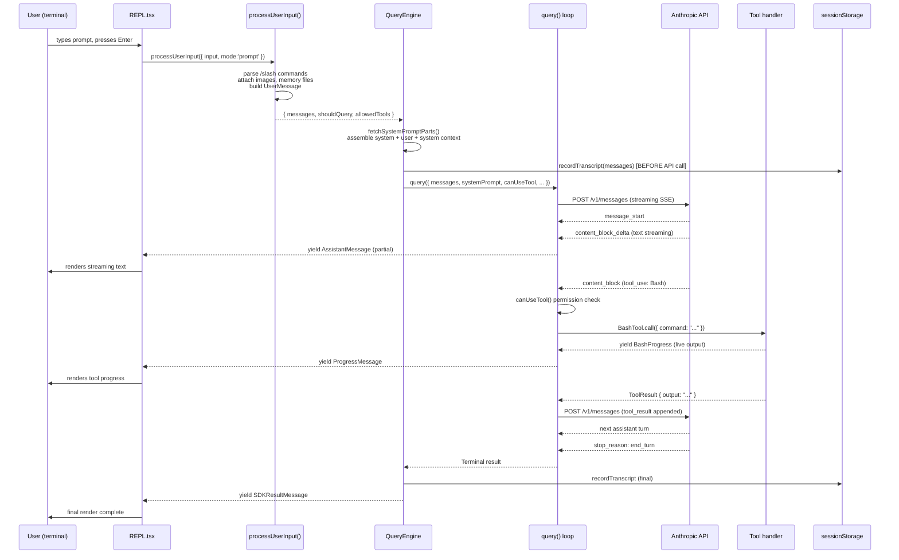
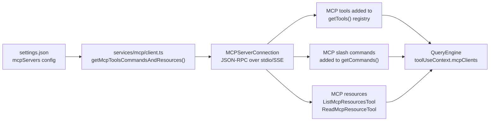
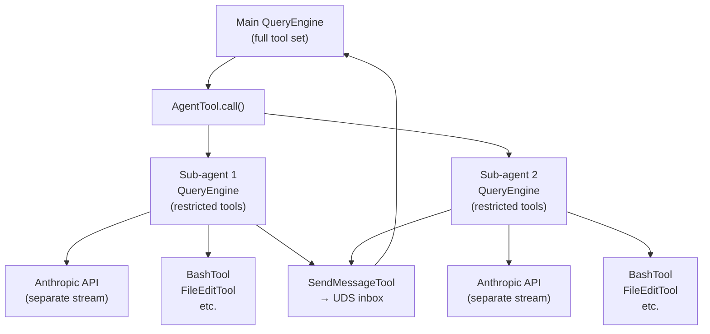

# Lesson 50 — Full Architecture Overview: How It All Fits Together

**Lesson 50 — Capstone**

How every system in Claude Code connects — boot to API call to rendered output. The complete picture.

---

## 01 The Big Picture

Over the previous 49 lessons we explored every subsystem in isolation: the boot sequence,
query engine, tool system, skills, agents, permissions, MCP, state management, and more.
This capstone lesson stitches them all together. By the end you will have a single mental
model that explains *exactly* what happens — at the code level — from the moment
you press Enter on a prompt to the moment the response finishes rendering.

> **Source files covered in this lesson**
> `main.tsx` -> `setup.ts` -> `QueryEngine.ts` ->
> `query.ts` -> `tools.ts` -> `Tool.ts` ->
> `bootstrap/state.ts` -> `state/AppStateStore.ts` ->
> `replLauncher.tsx` -> `screens/REPL.tsx` ->
> `services/api/` -> `services/mcp/`

Claude Code is a TypeScript application built on Bun, React/Ink (terminal UI), and the
Anthropic API. Its architecture has six clearly-separated layers that hand off
responsibility in sequence:

| Layer | Files | Purpose |
|-------|-------|---------|
| **Boot** | `main.tsx`, `setup.ts`, `entrypoints/init.ts` | Process startup, settings, migrations, session wiring |
| **UI Shell** | `replLauncher.tsx`, `screens/REPL.tsx`, `components/App.tsx` | Ink-rendered interactive terminal interface |
| **State** | `state/AppStateStore.ts`, `bootstrap/state.ts`, `state/store.ts` | Immutable AppState + global singleton state |
| **Query Engine** | `QueryEngine.ts`, `query.ts` | Conversation lifecycle, system prompt assembly, API streaming loop |
| **Tools** | `tools.ts`, `Tool.ts`, `tools/*/` | Capability registry: Bash, file I/O, agents, search, MCP, skills |
| **Services** | `services/api/`, `services/mcp/`, `services/compact/` | Anthropic API client, MCP connections, compaction |

## 02 Full Architecture Diagram

This ASCII diagram maps every major component and its relationship to the others.
Read it top-down: the user's keystroke flows downward through each layer until it
reaches the API, then the response bubbles back up through tools and the UI.

```
╔══════════════════════════════════════════════════════════════════════════════════╗
║                         CLAUDE CODE — FULL ARCHITECTURE                          ║
╚══════════════════════════════════════════════════════════════════════════════════╝

 ┌─────────────────────────────────────────────────────────────────────────────┐
 │  PROCESS ENTRY  (entrypoints/cli.tsx)                                        │
 │                                                                               │
 │  $ claude [flags] [prompt]                                                    │
 │       │                                                                       │
 │       ├─ fast paths: --version, --daemon-worker, bridge → exit early          │
 │       └─ dynamic import main.tsx → main()                                     │
 └───────────────────────────────┬─────────────────────────────────────────────┘
                                 │
 ┌───────────────────────────────▼─────────────────────────────────────────────┐
 │  MAIN.TSX  — Commander CLI wiring + orchestration                            │
 │                                                                               │
 │  TOP-LEVEL SIDE EFFECTS (before imports finish):                             │
 │    profileCheckpoint('main_tsx_entry')                                        │
 │    startMdmRawRead()          ← MDM policy reads (parallel subprocess)       │
 │    startKeychainPrefetch()    ← macOS keychain reads (parallel)              │
 │                                                                               │
 │  init()  ─────────────────────────────────────────────────────────────────►  │
 │    applySafeConfigEnvironmentVariables()   applyExtraCACertsFromConfig()      │
 │    setupGracefulShutdown()                 ensureMdmSettingsLoaded()          │
 │    initializeRemoteManagedSettingsLoadingPromise()                            │
 │    initializePolicyLimitsLoadingPromise()                                     │
 │    preconnectAnthropicApi()   ← early TCP connection warm-up                  │
 │                                                                               │
 │  runMigrations()  ── schema upgrades, model string migrations (v11)          │
 │  Commander.parse()  ── resolves: cwd, permissionMode, model, session flags   │
 └───────────────────────────────┬─────────────────────────────────────────────┘
                                 │
 ┌───────────────────────────────▼─────────────────────────────────────────────┐
 │  SETUP.TS  — Session initialization                                          │
 │                                                                               │
 │  setCwd(cwd)                                                                 │
 │  captureHooksConfigSnapshot()    initializeFileChangedWatcher()              │
 │  startUdsMessaging()             captureTeammateModeSnapshot()  [swarms]     │
 │  createWorktreeForSession()   [--worktree flag]                               │
 │  createTmuxSessionForWorktree()  [--tmux flag]                               │
 │  initSessionMemory()             initContextCollapse()  [feature gate]       │
 │  lockCurrentVersion()                                                        │
 │  getCommands() prefetch   loadPluginHooks()   processSessionStartHooks()     │
 └───────────────────────────────┬─────────────────────────────────────────────┘
                                 │
        ┌────────────────────────┴────────────────────────┐
        │  INTERACTIVE PATH                               │  HEADLESS PATH (--print/-p)
        ▼                                                 ▼
 ┌─────────────────────┐                       ┌─────────────────────┐
 │  replLauncher.tsx   │                       │  print.ts / SDK     │
 │  launchRepl()       │                       │  runHeadless()      │
 │    import App.tsx   │                       │  QueryEngine        │
 │    import REPL.tsx  │                       │  .submitMessage()   │
 │    renderAndRun()   │                       └──────────┬──────────┘
 └────────┬────────────┘                                  │
          │                                               │
 ┌────────▼─────────────────────────────────────────────────────────────────────┐
 │  INK TERMINAL UI  (react + ink)                                               │
 │                                                                               │
 │  components/App.tsx  ── AppState provider, context injection                 │
 │  screens/REPL.tsx    ── main interactive loop                                 │
 │    ├── components/PromptInput/   ← user types here                            │
 │    ├── components/messages/      ← assistant messages rendered                │
 │    ├── components/permissions/   ← tool permission dialogs                    │
 │    ├── components/tasks/         ← task list panel                            │
 │    ├── components/mcp/           ← MCP status                                 │
 │    └── screens/Doctor.tsx        ← /doctor command output                     │
 │                                                                               │
 │  state/AppStateStore.ts  ── DeepImmutable<AppState>                          │
 │    { settings, mainLoopModel, toolPermissionContext, messages,                │
 │      speculation, mcpClients, agentDefinitions, fileHistory, ... }            │
 └────────┬─────────────────────────────────────────────────────────────────────┘
          │  user submits prompt
          ▼
 ┌──────────────────────────────────────────────────────────────────────────────┐
 │  QUERY ENGINE  (QueryEngine.ts + query.ts)                                    │
 │                                                                               │
 │  QueryEngine.submitMessage(prompt)  ←── one instance per conversation        │
 │    │                                                                          │
 │    ├─ processUserInput()     ── /slash command handling, message prep         │
 │    ├─ recordTranscript()     ── persist user message BEFORE API call         │
 │    ├─ fetchSystemPromptParts()  ── assemble system prompt:                   │
 │    │     defaultSystemPrompt + userContext + systemContext                    │
 │    │     + customSystemPrompt + appendSystemPrompt + memoryMechanics         │
 │    ├─ getSlashCommandToolSkills()   loadAllPluginsCacheOnly()                │
 │    └─ yield buildSystemInitMessage()   ── SDK init event                     │
 │                                                                               │
 │  query(params)  ──────────────────────────────────────────────────────────►  │
 │    queryLoop()  ── async generator, one iteration per API turn               │
 │      │                                                                        │
 │      ├─ buildQueryConfig()       ── snapshot statsig / env / session state   │
 │      ├─ calculateTokenWarningState()   autoCompact tracking                  │
 │      ├─ deps.sendRequest()       ── calls services/api/claude.ts             │
 │      │    └── streams: text_delta, tool_use, thinking blocks                 │
 │      ├─ executePostSamplingHooks()  ── user-defined hooks run here           │
 │      ├─ StreamingToolExecutor    ── parallel tool execution                  │
 │      │    └── runTools()         ── dispatches to individual tool handlers   │
 │      ├─ checkTokenBudget()       ── 500k budget continuation logic           │
 │      ├─ buildPostCompactMessages()  ── context compaction if needed          │
 │      └─ loop continues until stop_reason = end_turn or maxTurns              │
 └────────┬─────────────────────────────────────────────────────────────────────┘
          │  tool_use blocks
          ▼
 ┌──────────────────────────────────────────────────────────────────────────────┐
 │  TOOL SYSTEM  (tools.ts → Tool.ts → tools/*/ToolName.ts)                     │
 │                                                                               │
 │  getAllBaseTools()  ──  the canonical registry (synced to Statsig cache key) │
 │    BashTool          FileReadTool      FileEditTool    FileWriteTool          │
 │    GlobTool          GrepTool          WebFetchTool    WebSearchTool          │
 │    AgentTool         SkillTool         TodoWriteTool   LSPTool                │
 │    ListMcpResourcesTool  ReadMcpResourceTool  ToolSearchTool                  │
 │    TaskCreateTool    TaskUpdateTool    TaskListTool    TaskGetTool            │
 │    EnterPlanModeTool ExitPlanModeV2Tool EnterWorktreeTool ExitWorktreeTool   │
 │    ConfigTool        AskUserQuestionTool  TungstenTool  BriefTool            │
 │    NotebookEditTool  [+ feature-gated: SleepTool, MonitorTool, WorkflowTool] │
 │                                                                               │
 │  canUseTool()  ──  permission gate (PermissionMode: default/auto/bypass)     │
 │    getDenyRuleForTool()    alwaysAllowRules    ToolPermissionContext          │
 │                                                                               │
 │  Each Tool implements:                                                        │
 │    name, description, inputSchema (Zod)                                       │
 │    isEnabled() → bool                                                         │
 │    call(input, context) → AsyncGenerator<ToolProgressData, ToolResult>       │
 │    renderToolResult() → React component (for Ink UI)                         │
 └────────┬─────────────────────────────────────────────────────────────────────┘
          │  special tools delegate further
          │
          ├──────────────────────────────────────────────────────┐
          │  AgentTool                                           │
          │  Spawns sub-QueryEngine with restricted tool set     │
          │  Swarm: TeamCreateTool, SendMessageTool, UDS inbox   │
          │                                                      │
          ├──────────────────────────────────────────────────────┘
          │
          ├──────────────────────────────────────────────────────┐
          │  MCP Tools (ListMcpResourcesTool, ReadMcpResourceTool)│
          │  services/mcp/client.ts  ── connects to MCP servers  │
          │  MCPServerConnection → JSON-RPC over stdio / SSE     │
          └──────────────────────────────────────────────────────┘
          │
          ▼
 ┌──────────────────────────────────────────────────────────────────────────────┐
 │  ANTHROPIC API  (services/api/claude.ts)                                      │
 │                                                                               │
 │  sendRequest()  ── streaming SSE via @anthropic-ai/sdk                       │
 │    request includes:  model, system, messages[], tools[], max_tokens          │
 │    betas:  computer-use, extended-thinking, ...                               │
 │    task_budget (output_config.task_budget if configured)                      │
 │                                                                               │
 │  Stream events yielded back through query() generator:                        │
 │    message_start → content_block_start → content_block_delta                 │
 │    → content_block_stop → message_delta → message_stop                       │
 │                                                                               │
 │  withRetry()   ── handles 529 overload, 529 quota, network errors            │
 │  accumulateUsage()  ── tracks input/output tokens for cost display           │
 └────────┬─────────────────────────────────────────────────────────────────────┘
          │  response streams back
          ▼
 ┌──────────────────────────────────────────────────────────────────────────────┐
 │  SESSION STORAGE  (utils/sessionStorage.ts)                                   │
 │                                                                               │
 │  recordTranscript()  ── write messages to ~/.claude/projects/<hash>/          │
 │  flushSessionStorage()  ── drain write queue (JSONL format)                  │
 │  cacheSessionTitle()    ── first message becomes session title               │
 │  loadTranscriptFromFile()  ── --resume / --continue path                     │
 └────────┬─────────────────────────────────────────────────────────────────────┘
          │  messages yielded back to UI
          ▼
 ┌──────────────────────────────────────────────────────────────────────────────┐
 │  INK RENDER  (screens/REPL.tsx → components/)                                │
 │                                                                               │
 │  useLogMessages hook  ── appends messages to AppState                        │
 │  AssistantMessage component  ── renders text / thinking / tool results       │
 │  ProgressMessage component   ── streaming in-progress display                │
 │  PermissionRequest component ── blocks render, awaits user decision          │
 │  ink.ts  ── thin wrapper: render(), unmount(), stdout write                  │
 └──────────────────────────────────────────────────────────────────────────────┘

 ═══════════════════  CROSS-CUTTING SYSTEMS  ═══════════════════════════════════

  bootstrap/state.ts ── Global singleton (NOT React state):
    sessionId, cwd, originalCwd, projectRoot, totalCostUSD,
    modelUsage, isInteractive, mainLoopModelOverride, sdkBetas,
    hook registry, OTel meter, token budget counters

  utils/hooks/ ── Lifecycle hooks (settings.json):
    PreToolUse, PostToolUse, PreCompact, PostCompact,
    Notification, Stop, FileChanged, SessionStart

  services/analytics/  ── Statsig + GrowthBook feature flags
    logEvent() → statsig  initializeGrowthBook()
    getFeatureValue_CACHED_MAY_BE_STALE()

  utils/permissions/  ── PermissionMode: default | auto | bypass
    canUseTool() → allow | deny | ask-user

  services/compact/  ── Auto-compact when context window fills
    isAutoCompactEnabled()   buildPostCompactMessages()
    snipCompact (HISTORY_SNIP)   reactiveCompact (REACTIVE_COMPACT)

  memdir/  ── CLAUDE.md memory injection
    loadMemoryPrompt()   nested memory attachment triggers

  skills/  ── User-defined skill .md files
    getSlashCommandToolSkills()   SkillTool.call()

  plugins/  ── Versioned plugin registry
    loadAllPluginsCacheOnly()   initBundledPlugins()
```

## 03 Data Flow: User Prompt to API Response

Now let's trace a single user message — say `"refactor this function"` —
through the entire stack. Every numbered step maps to real code in the source tree.



> **Critical insight**
> The transcript is written **before** the API call, not after.
> This is intentional: if the process is killed mid-request, the session is still
> resumable. See `QueryEngine.ts:450` for the comment explaining this design decision.

## 04 Boot Sequence Deep Recap

The boot sequence is carefully orchestrated to minimize time-to-first-render.
Three categories of work run in parallel as early as possible:

### Parallel at import time — Background I/O

`startMdmRawRead()` — MDM policy plutil subprocesses.
`startKeychainPrefetch()` — macOS keychain reads.
Both fire before the 135ms module eval completes.

### After init() — Network Warm-up

`preconnectAnthropicApi()` establishes a TCP connection to the API endpoint before the user types anything, so the first API request doesn't pay TCP handshake cost.

### After first render — Deferred Prefetches

`startDeferredPrefetches()` — user/git context, tips, model capabilities, file count, change detectors. Runs *after* paint so it doesn't block the prompt.

### setup.ts priority — Session Wiring

`captureHooksConfigSnapshot()` must run after `setCwd()` but before any query. The hooks config is read once and frozen so mid-session file modifications can't inject new hooks.

### setup.ts fire-and-forget — Plugin Cache

`getCommands()` and `loadPluginHooks()` are prefetched as background tasks. They populate caches consumed at first query time without blocking the render path.

### Migrations (main.tsx) — Config Upgrades

`runMigrations()` checks `migrationVersion` against `CURRENT_MIGRATION_VERSION=11` and runs only the needed model string / settings schema migrations.

<details>
  <summary>Why does main.tsx import everything statically but still feel fast?</summary>

The ~135ms module eval cost of all static imports is overlapped with the
`startMdmRawRead()` and `startKeychainPrefetch()` subprocess
calls that fire at the very top of the file before any imports complete.
By the time JavaScript finishes evaluating the module graph, both subprocess
calls have already been dispatched to the OS.

Heavy modules like OpenTelemetry (~400KB) and gRPC (~700KB) are lazy-loaded
via dynamic `import()` inside `init()` only when telemetry
is actually needed — they never touch the critical path.

React and Ink are also lazy: `launchRepl()` in `replLauncher.tsx`
only `import()`s `App.tsx` and `REPL.tsx` at call
time. In headless mode (`-p`), these are never loaded at all.

</details>

## 05 QueryEngine Internals

`QueryEngine` (introduced in a later refactor) extracts what was the
monolithic `ask()` function into a class that owns the full conversation
lifecycle. One instance lives per conversation session.

### State the engine owns

```typescript
class QueryEngine {
  private config: QueryEngineConfig       // tools, commands, mcpClients, model, ...
  private mutableMessages: Message[]       // full conversation history (grows each turn)
  private abortController: AbortController  // shared with all tools in this session
  private permissionDenials: SDKPermissionDenial[]  // accumulated for SDK result
  private totalUsage: NonNullableUsage     // token counts across all turns
  private readFileState: FileStateCache   // snapshot of files read this session
  private discoveredSkillNames: Set<string> // skills seen in this turn (for telemetry)
  private loadedNestedMemoryPaths: Set<string> // CLAUDE.md files already injected
}
```

### submitMessage() — the turn lifecycle

Each call to `submitMessage()` is an async generator yielding
`SDKMessage` events. The sequence every turn:

| Step | Code | Purpose |
|------|------|---------|
| 1. Process slash commands | `processUserInput()` | Handle /commands, build UserMessage array, determine shouldQuery |
| 2. Persist user message | `recordTranscript(messages)` | Write to disk BEFORE API so kill-mid-request is resumable |
| 3. Assemble system prompt | `fetchSystemPromptParts()` | Combine default + custom + memory + coordinator context |
| 4. Load skills + plugins | `getSlashCommandToolSkills()` | Cache-only load for headless; full refresh for interactive |
| 5. Yield system init | `buildSystemInitMessage()` | SDK callers receive the list of tools, commands, agents |
| 6. Enter query loop | `query()` | Streaming API call + tool execution until end_turn |
| 7. Yield result | `SDKResultMessage` | Final cost, usage, permission_denials, stop_reason |

### The query() loop — iteration anatomy

> **Key invariant**
> The query loop is a pure async generator — it yields each message as it streams
> and only advances to the next iteration when all tool calls in the current turn
> complete. This is what enables the REPL to display live streaming output while
> tools run in parallel.

```typescript
// query.ts — simplified loop skeleton
async function* queryLoop(params) {
  let state = { messages, turnCount: 1, autoCompactTracking, ... }
  const config = buildQueryConfig()   // snapshot env/statsig state

  while (true) {
    // 1. Optionally start skill/job prefetch (async, consumes settled results only)
    // 2. Send streaming API request via deps.sendRequest()
    for await (const event of streamEvents) {
      yield event  // passes text deltas directly to REPL
      if (event.type === 'tool_use') collectToolUse(event)
    }

    // 3. Check stop reason
    if (stopReason === 'end_turn') return 'success'

    // 4. Execute tools (StreamingToolExecutor — parallel where possible)
    for await (const result of runTools(toolUseBlocks, canUseTool, context)) {
      yield result
    }

    // 5. Token budget / compact checks → may compact and continue
    // 6. Append tool_results to messages, increment turnCount, loop
  }
}
```

## 06 Tool System Architecture

Every capability Claude can invoke is a `Tool`. The tool system is
intentionally flat — there is no tool hierarchy, just a registry function
`getAllBaseTools()` in `tools.ts` that returns the authoritative list.

### Tool interface (Tool.ts)

```typescript
// Simplified Tool interface
interface Tool {
  name: string                                         // must be stable (used in Statsig cache key)
  description: string                                  // injected into system prompt
  inputSchema: ZodSchema                             // validation before call()
  isEnabled(): boolean                               // feature-gate / env check
  call(input, context: ToolUseContext):               // async generator
    AsyncGenerator<ToolProgressData, ToolResult>
  renderToolResult(result, context): React.ReactNode  // Ink UI rendering
}
```

### ToolUseContext — the tool's window into the world

Every tool call receives a `ToolUseContext` that bundles together everything
the tool might need without coupling it to global state:

| Property | Type | Purpose |
|----------|------|---------|
| `messages` | `Message[]` | Full conversation history |
| `mainLoopModel` | `ModelSetting` | Current model for sub-agent spawning |
| `tools` | `Tools` | Available tool set (for AgentTool to pass down) |
| `mcpClients` | `MCPServerConnection[]` | Active MCP connections |
| `agentDefinitions` | `AgentDefinitionsResult` | Custom agent configs |
| `abortController` | `AbortController` | Shared abort signal (Ctrl-C propagation) |
| `readFileState` | `FileStateCache` | Snapshot of files read (for diff/undo) |
| `setAppState` | `Setter<AppState>` | Tools can mutate UI state (e.g. TodoWriteTool) |
| `handleElicitation` | `ElicitFn` | MCP URL elicitation (OAuth flows) |

### Feature-gated tools

Many tools are conditionally included based on `feature()` flags
(Bun bundle-time dead code elimination) or environment variables. This keeps
the tool list deterministic for Anthropic's prompt cache key:

```typescript
// tools.ts — feature gate pattern
const SleepTool =
  feature('PROACTIVE') || feature('KAIROS')
    ? require('./tools/SleepTool/SleepTool.js').SleepTool
    : null

// getAllBaseTools() filters nulls from the array
// NOTE: this list is synced to Statsig console for prompt cache invalidation
```

## 07 State Management: Two-Layer Model

Claude Code has a two-layer state model. Understanding which layer to use for
what is essential to understanding the codebase.

### Layer 1 — Global Singleton: bootstrap/state.ts

Process-lifetime constants: sessionId, cwd, projectRoot, model, auth token, telemetry meter, hook registry. Explicitly NOT a React store. Comments in the file warn: "DO NOT ADD MORE STATE HERE".

### Layer 2 — React State: state/AppStateStore.ts

`DeepImmutable<AppState>` — everything the UI needs: messages, mcpClients, permission context, speculation state, settings, task list, agent definitions, file history. Updated immutably via `setAppState(prev => ...)`.

The key design principle: **bootstrap/state.ts is a module-level singleton
(plain JS object) while AppState is React context**. This separation means
the query engine and tools can access session identity without importing React,
while the UI can re-render reactively on any AppState change.

```typescript
// bootstrap/state.ts — the singleton shape (partial)
type State = {
  originalCwd: string
  projectRoot: string
  totalCostUSD: number
  totalAPIDuration: number
  cwd: string
  modelUsage: { [modelName: string]: ModelUsage }
  mainLoopModelOverride: ModelSetting | undefined
  isInteractive: boolean
  sessionId: SessionId
  sdkBetas: BetaMessageStreamParams['betas']
  hookRegistry: RegisteredHookMatcher[]
  meter: Meter | undefined
  tokenBudgetInfo: { remainingTokens: number; ... }
  // ... ~40 more fields, all process-lifetime
}

// state/AppStateStore.ts — the React state shape (partial)
type AppState = DeepImmutable<{
  settings: SettingsJson
  mainLoopModel: ModelSetting
  toolPermissionContext: ToolPermissionContext
  messages: Message[]
  mcpClients: MCPServerConnection[]
  agentDefinitions: AgentDefinitionsResult
  speculation: SpeculationState
  fileHistory: FileHistoryState
  plugins: LoadedPlugin[]
  tasks: TaskState | null
  // ... ~50 more fields
}>
```

## 08 Session Management

A "session" in Claude Code is a persistent conversation with a unique UUID.
Sessions are stored as JSONL transcript files under
`~/.claude/projects/<cwd-hash>/<session-id>.jsonl`.

### Session lifecycle

```typescript
// Startup: generate or restore session ID
getSessionId()          // reads bootstrap/state.ts
registerSession()        // registers in concurrent sessions tracking
countConcurrentSessions() // used for display in status bar

// During conversation:
recordTranscript(messages)   // enqueues write (lazy 100ms JSONL flush)
flushSessionStorage()         // forced flush (EAGER_FLUSH env / cowork)
cacheSessionTitle()           // first user message → title for resume UI

// Resume path (--continue / --resume):
loadTranscriptFromFile()      // reads JSONL back into Message[]
processResumedConversation()  // validates + replays into initial messages
```

> **Write queue design**
> Transcript writes are lazy (100ms drain timer) for performance. The `recordTranscript()`
> call is fire-and-forget for assistant messages but awaited for user messages.
> This is intentional — the comment in `QueryEngine.ts:727` explains that
> awaiting assistant writes would block the streaming generator, preventing
> `message_delta` events from processing.

## 09 How MCP Plugs In

MCP (Model Context Protocol) servers connect as `MCPServerConnection` objects
held inside `AppState.mcpClients`. They are initialized before the first
query and passed into every `ToolUseContext`.



MCP tools are *not* in `getAllBaseTools()` — they are dynamically
added alongside the base tools at session startup via
`getMcpToolsCommandsAndResources()`. This is why MCP tool names can
conflict with base tool names: the deduplication happens at load time.

## 10 The Permission Gate

Every tool call passes through `canUseTool()` before execution.
This single function is the architectural choke point for all permission decisions.

```typescript
// The permission gate — called by query.ts before runTools()
const wrappedCanUseTool: CanUseToolFn = async (
  tool, input, toolUseContext, assistantMessage, toolUseID, forceDecision
) => {
  const result = await canUseTool(tool, input, toolUseContext, ...)
  if (result.behavior !== 'allow') {
    // Track for SDK result reporting
    this.permissionDenials.push({ tool_name, tool_use_id, tool_input })
  }
  return result
}
```

| Permission Mode | Behavior | Configured via |
|----------------|----------|----------------|
| `default` | Ask user for any tool not in allow-list | Normal CLI startup |
| `auto` | Automatically allow safe tools, block dangerous | `--permission-mode auto` |
| `bypass` | Allow all tools without asking | `--dangerously-skip-permissions` |
| alwaysAllow rules | Per-tool allow-list (from settings + session) | User accepts during session |

## 11 Context Compaction

When the conversation grows large enough to threaten the model's context window,
Claude Code triggers automatic compaction. This is transparent to the user.

### Trigger — Token threshold

`calculateTokenWarningState()` compares current context token count against the model's context window. At ~80% fill, auto-compact triggers.

### Process — buildPostCompactMessages()

Sends the conversation to Claude with a summarization prompt. Returns a single compact summary message plus any preserved recent messages.

### HISTORY_SNIP — Snip compaction

Feature-gated alternative: `snipCompact.ts` yields a `compact_boundary` system message. The SDK path truncates in-memory; the REPL preserves full scrollback and projects on demand.

### Budget tracking — 500k continuation

`checkTokenBudget()` handles the case where a single API response exceeds max_output_tokens. It auto-continues with "Please continue" until the response is complete.

## 12 Hooks: User-Defined Lifecycle Events

Hooks let users inject shell commands or callbacks at specific lifecycle points.
They are configured in `settings.json` and captured once at startup
(immutable snapshot pattern).

| Hook type | Fires when | Can block? |
|-----------|-----------|------------|
| `PreToolUse` | Before any tool executes | Yes — can deny the tool |
| `PostToolUse` | After any tool completes | No |
| `PreCompact` | Before context compaction | No |
| `PostCompact` | After compaction finishes | No |
| `Stop` | When Claude outputs stop_reason=end_turn | Yes — can continue |
| `Notification` | Any assistant notification event | No |
| `FileChanged` | Watched file modified on disk | No |
| `SessionStart` | Before first query in new session | Yes — delays first query |

> **Security invariant**
> `captureHooksConfigSnapshot()` must run *after* `setCwd()`
> and *before* any query. Once snapshotted, the hooks config is frozen for the
> session. This prevents a malicious project from modifying `settings.json`
> mid-session to inject hook commands that execute with the current permissions.

## 13 Two Modes: Interactive vs Headless

The codebase has two distinct runtime paths that share `QueryEngine` but
differ significantly in their UI and startup behavior:

| Aspect | Interactive (default) | Headless (`-p` / `--print`) |
|--------|----------------------|----------------------------|
| UI | Ink/React terminal rendering | stdout text output only |
| Trust dialog | Shown on first launch | Skipped (implicit trust) |
| Session transcript | Awaited before API call | Fire-and-forget |
| React imports | Fully loaded | Never imported |
| Plugin prefetch | Background during setup | Skipped (`isBareMode()`) |
| Deferred prefetches | Run after first render | Skipped entirely |
| QueryEngine path | REPL -> `ask()` | `print.ts` -> `QueryEngine.submitMessage()` |
| Entrypoint label | `cli` | `sdk-cli` |

> **Bare mode flag**
> `isBareMode()` returns true when `--print`/`-p` is active.
> The codebase uses this flag extensively to skip all interactive-only work.
> This is also the flag SDK callers rely on to get predictable, low-latency execution.

## 14 Agent Swarms and Sub-Agents

The `AgentTool` enables recursive execution: Claude can spawn sub-agents,
each with their own `QueryEngine` instance and a restricted tool set.



In swarm mode (`ENABLE_AGENT_SWARMS=true`), agents communicate via
the Unix Domain Socket (UDS) messaging server started in `setup.ts`.
Each agent registers with `TeamCreateTool` and can send messages back
to the coordinator via `SendMessageTool`.

## 15 Master Timeline: First Keystroke to First Token

Everything together — the complete timeline from cold start to streaming response:

```
 t=0ms    $ claude                              (cli.tsx main())
 t=1ms    profileCheckpoint('cli_entry')
 t=1ms    startMdmRawRead()                     (MDM subprocess fired)
 t=1ms    startKeychainPrefetch()               (keychain reads fired)
 t=136ms  profileCheckpoint('main_tsx_imports_loaded')   (module eval done)
 t=136ms  initializeWarningHandler()
 t=137ms  eagerLoadSettings()                   (--settings flag parsed)
 t=140ms  Commander.parse()                     (argv → options struct)
 t=141ms  init()                                (entrypoints/init.ts)
 t=142ms    applySafeConfigEnvironmentVariables()
 t=143ms    applyExtraCACertsFromConfig()
 t=144ms    setupGracefulShutdown()
 t=145ms    ensureMdmSettingsLoaded()           (waits for MDM subprocess)
 t=160ms    preconnectAnthropicApi()            (TCP warm-up)
 t=161ms  runMigrations()                       (if migrationVersion < 11)
 t=163ms  setup(cwd, permissionMode, ...)
 t=164ms    setCwd(cwd)
 t=165ms    captureHooksConfigSnapshot()        (IMPORTANT: before any query)
 t=166ms    initializeFileChangedWatcher()
 t=168ms    startUdsMessaging()                 [if !bareMode]
 t=170ms    getCommands() prefetch              (background)
 t=171ms    loadPluginHooks()                   (background)
 t=172ms    initSessionMemory()
 t=173ms    lockCurrentVersion()               (background)
 t=174ms  logEvent('tengu_started')
 t=175ms  prefetchApiKeyFromApiKeyHelperIfSafe()
 t=180ms  showSetupScreens()                   (trust dialog if first run)
 t=182ms  launchRepl()                          (replLauncher.tsx)
 t=183ms    import App.tsx, REPL.tsx            (lazy)
 t=190ms  FIRST RENDER ─────────────────────────────── user sees prompt
 t=191ms  startDeferredPrefetches()             (after render)
 t=191ms    initUser(), getUserContext()         (background)
 t=192ms    getSystemContext()                  (git status, etc.)
 t=193ms    getRelevantTips()                   (background)
 t=194ms    refreshModelCapabilities()          (background)
 t=195ms    settingsChangeDetector.initialize() (background)

 [user types prompt and hits Enter]

 t+0ms    processUserInput()                   (slash commands, UserMessage)
 t+2ms    fetchSystemPromptParts()             (system prompt assembly)
 t+3ms    recordTranscript(messages)           (PERSIST BEFORE API CALL)
 t+5ms    getSlashCommandToolSkills()          (cache-only)
 t+6ms    yield buildSystemInitMessage()
 t+7ms    query() → queryLoop()
 t+8ms    buildQueryConfig()                   (statsig/env snapshot)
 t+9ms    deps.sendRequest()                   (Anthropic API SSE stream)
 t+50ms   FIRST TOKEN ARRIVES ─────────────────────────── user sees text
```

## 16 Key Design Patterns You'll See Everywhere

### 1. Async generator threading

The entire data flow from API to UI is a chain of async generators.
`query()` yields `StreamEvent`s, `QueryEngine.submitMessage()`
yields `SDKMessage`s, and the REPL consumes them.
This enables true streaming without callbacks or event buses.

### 2. Dead code elimination via `feature()`

Bun's bundle-time `feature('FLAG_NAME')` completely removes disabled
feature branches from the compiled binary. This means the tool list is deterministic
per build (important for Anthropic's prompt cache key), and disabled features add
zero runtime overhead.

### 3. Cache-warming for latency

Critical paths (system prompt, tools, commands, model capabilities) are all
pre-warmed in parallel during setup/startup. By the time the user submits
their first prompt, nearly all expensive I/O has already completed.
The pattern: fire async work, discard the promise, and memo/cache the result.

### 4. Immutable AppState + mutable bootstrap/state

React state is immutable (`DeepImmutable`) to prevent accidental mutation
and enable React's change detection. But session-level constants (cwd, sessionId,
model) live in a plain module singleton that is intentionally not React state —
these values are accessed by non-React code deep inside the query engine.

### 5. The `isBareMode()` fast path

Every expensive startup operation is guarded by `if (!isBareMode())`.
This single flag (true when running headless) skips React, Ink, UDS messaging,
plugin prefetch, deferred prefetches, and all interactive-only setup. Headless
execution becomes nearly pure compute.

### 6. Parallel subprocess investment

Instead of sequential I/O, the codebase fires subprocesses and async operations
as early as possible and lets them run in parallel with JavaScript execution.
`startMdmRawRead()` and `startKeychainPrefetch()` both fire
before the 135ms module graph finishes evaluating. By the time the code that
consumes their results runs, they're usually already done.

## Capstone Takeaways

- **Boot is parallel by design.** MDM reads, keychain reads, TCP warm-up, and command prefetching all fire before they're needed to eliminate sequential I/O cost.
- **QueryEngine is the conversation owner.** One instance per conversation. It holds message history, token usage, file cache, and abort controller across all turns.
- **The query loop is a pure async generator.** Every message — text delta, tool progress, tool result — flows through `yield` from API to UI. No callbacks, no event buses.
- **Tools are a flat registry.** `getAllBaseTools()` in `tools.ts` is the single source of truth. The list is stable per build for prompt cache purposes.
- **Two state layers serve different masters.** `bootstrap/state.ts` (singleton) for the query engine; `AppStateStore.ts` (React) for the UI.
- **Permissions are a single choke point.** `canUseTool()` is called before every tool execution. All three permission modes (default, auto, bypass) flow through it.
- **The transcript is written before the API call.** This ensures sessions are resumable even if the process dies mid-request.
- **Headless mode is architecturally distinct.** `isBareMode()` strips out React, Ink, UDS, plugins, and all deferred work. SDK callers get near-zero overhead.
- **Feature gates are bundle-time, not runtime.** `feature('FLAG')` is dead-code eliminated by Bun at build time. Disabled features genuinely do not exist in the binary.
- **MCP servers are first-class peers.** Their tools, commands, and resources integrate into the same registries as built-in tools and are passed through the same `ToolUseContext`.

## Capstone Quiz

**Q1.** In what order do these three events happen during startup?
A) `startKeychainPrefetch()`  B) Module imports complete  C) Commander.parse()

- **A)** B -> A -> C (imports first, then keychain, then parse)
- **B) (correct)** A -> B -> C (keychain fires before imports finish, then parse)
- **C)** C -> A -> B (parse first, then keychain, then imports)
- **D)** A -> C -> B (keychain fires, then parse, then imports)

> **Answer:** B. `startKeychainPrefetch()` is a top-level side effect that fires before the module graph finishes evaluating (~135ms). Commander.parse() runs well after all imports complete.

---

**Q2.** Why is `recordTranscript(messages)` called BEFORE the API request in `QueryEngine.submitMessage()`?

- **A)** To pre-populate the cache for faster resume
- **B) (correct)** So the session is resumable if the process is killed before the API responds
- **C)** Because the API requires the transcript to be written first
- **D)** To reduce latency by writing in parallel with the API call

> **Answer:** B. The comment at line ~444 in QueryEngine.ts explicitly explains: if the process is killed before the API responds, the transcript would only contain queue-operation entries. Writing before the call makes the session resumable from the point the user message was accepted.

---

**Q3.** What is the difference between `bootstrap/state.ts` and `state/AppStateStore.ts`?

- **A)** bootstrap/state.ts is for interactive mode; AppStateStore.ts is for headless mode
- **B)** bootstrap/state.ts holds tool state; AppStateStore.ts holds session state
- **C) (correct)** bootstrap/state.ts is a plain JS module singleton; AppStateStore.ts is React state (DeepImmutable) for UI re-rendering
- **D)** They are functionally identical — one is the source, the other a cache

> **Answer:** C. bootstrap/state.ts is a plain module-level singleton (process-lifetime constants like sessionId, cwd, totalCostUSD) accessible without React. AppStateStore.ts is React context with DeepImmutable\<AppState\> for everything the UI needs to render.

---

**Q4.** MCP tool names are registered in `getAllBaseTools()` in tools.ts. True or false?

- **A) (correct)** False — MCP tools are dynamically added via getMcpToolsCommandsAndResources() at session startup
- **B)** True — all tools including MCP are in getAllBaseTools()
- **C)** False — MCP tools are never part of the tool registry; they use a separate path
- **D)** True — but only if the MCP server is listed in the bundled registry

> **Answer:** A (False). getAllBaseTools() only contains statically-known built-in tools. MCP tools are discovered at runtime via getMcpToolsCommandsAndResources() and merged into the tool set that gets passed to QueryEngine.

---

**Q5.** Why must `captureHooksConfigSnapshot()` run after `setCwd()` but before any query?

- **A)** For performance — reading hooks from the correct directory is faster after setCwd
- **B)** Because hooks are stored relative to cwd and can't be found before it's set
- **C) (correct)** Security: to prevent a malicious project from modifying settings.json mid-session to inject hook commands with current permissions
- **D)** So that hook commands get the correct working directory in their environment

> **Answer:** C. This is a security invariant. By snapshotting the hooks config once at startup, the session is protected against a project that tries to modify settings.json to inject new hook commands that would execute with the session's existing permissions.

---

## Course Complete

You've completed all 50 lessons of the Claude Code source code course.
You now have a complete mental model of how Claude Code works — from the
first keystroke to the final rendered token. This knowledge is the foundation
for contributing to, extending, or simply deeply understanding one of the most
sophisticated AI coding tools ever built.
